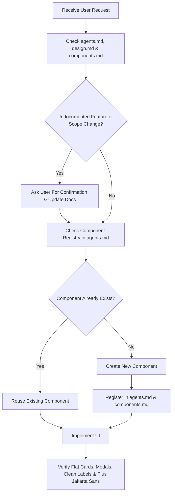

# Agent Instructions & Operational Rules (`agents.md`)

This document defines the core operational protocols, architectural rules, and decision-making workflows for any AI agent working on this codebase.

---

## 1. Core Operating Principles

### 1.1 Documentation-First & Sync Rule (Ask Before Deviating)
- **Source of Truth:** The documentation suite is the single source of truth:
  - [agents.md](file:///d:/BUILDATHON/library/agents.md) (Operational protocols & reusable component registry)
  - [design.md](file:///d:/BUILDATHON/library/design.md) (Design tokens, flat cards, modals, typography)
  - [components.md](file:///d:/BUILDATHON/library/components.md) (Reusable component catalog)
  - [requirements.md](file:///d:/BUILDATHON/library/requirements.md) (Functional & non-functional requirements)
  - [plan.md](file:///d:/BUILDATHON/library/plan.md) (Technical architecture & system blueprint)
  - [phases.md](file:///d:/BUILDATHON/library/phases.md) (Implementation roadmap & milestones)
  - [database.md](file:///d:/BUILDATHON/library/database.md) (PostgreSQL schema & RLS security)
- **Never Make Unilateral Changes:** If any implementation detail, new feature, architectural choice, or update is **not explicitly covered in the documentation**, pause immediately and ask the user:
  > *"This update is not covered in our documentation (`agents.md` / `design.md` / `components.md` / `requirements.md` / `plan.md` / `phases.md` / `database.md`). Would you like me to update the documentation first before proceeding?"*
- Always align with the user before introducing dependencies, restructuring layouts, or adding unrequested functionality.

### 1.2 Mandatory Component Reuse & Deduplication Protocol
- **Check Before Build:** Before creating or remaking any component, inspect Section 4 ("Active Reusable Components Registry") in this file as well as [components.md](file:///d:/BUILDATHON/library/components.md).
- **Zero Duplicate Rule:** If a suitable component exists, reuse it. **Do NOT recreate or duplicate existing components.**
- **Immediate Registration:** Whenever a new reusable component is created, register it immediately in Section 4 of this file (`agents.md`) and in [components.md](file:///d:/BUILDATHON/library/components.md).

---

## 2. Mandatory UI & Design Rules

All code written must strictly adhere to the following UI principles defined in [design.md](file:///d:/BUILDATHON/library/design.md):

### 2.1 Roles & Actions: Popup Modals for Create and Edit
- All **Create** flows must open inside a centered **Popup Modal**.
- All **Edit** flows must open inside a centered **Popup Modal**.
- Do NOT use inline editing or navigate to separate pages for create/edit operations.
- Modals must include a clear backdrop overlay, clean header with title and close button, compact form inputs, and action buttons (`Cancel` / `Save` or `Submit`).

### 2.2 Delete: Explicit Confirmation Modal
- Every **Delete** or destructive action MUST trigger an explicit **Delete Confirmation Modal**.
- The confirmation modal must:
  - Display the specific name of the item being deleted.
  - Warn that the action is irreversible.
  - Provide a clear `Cancel` button (default focus) and a distinct destructive `Delete` button.
- **Never perform silent or direct one-click deletions.**

### 2.3 Flattened Cards (Strictly No Nested Cards)
- All cards must use a **flat layout structure**.
- **Never nest cards inside other cards.**
- To organize card content, use subtle background contrast, spacing, dividers, or badges—never container cards inside cards.

### 2.4 Remove Useless Labels and Descriptions
- Eliminate redundant and obvious text labels (e.g., avoid "Title:", "Description:", "Status:", "Due Date:").
- Use clean visual hierarchy, prominent typography, badges, icons, and contextual inputs instead of wordy descriptive labels.
- Keep form placeholders concise and remove repetitive helper text under fields.

### 2.5 Typography: Plus Jakarta Sans
- Use **Plus Jakarta Sans** as the primary font family across all components and typography tokens:
  ```css
  font-family: 'Plus Jakarta Sans', system-ui, -apple-system, BlinkMacSystemFont, 'Segoe UI', Roboto, sans-serif;
  ```

---

## 3. Agent Task Execution Workflow

Follow this systematic workflow for every request:



### Pre-Implementation Checklist:
- [ ] Has the user approved any new or undocumented requirements?
- [ ] Did I check the registry below to prevent duplicate components?
- [ ] Are Create and Edit operations implemented in a Popup Modal?
- [ ] Does Delete trigger an explicit Confirmation Modal?
- [ ] Are all cards flattened with zero nested cards?
- [ ] Are redundant labels and descriptions removed?
- [ ] Is `Plus Jakarta Sans` font applied consistently?

---

## 4. Active Reusable Components Registry (Check Before Build)

> **Agents MUST consult this table before building any component to ensure NO duplicates are created.**

| Component Name | Category | File Path | Status | Purpose & Notes |
| :--- | :--- | :--- | :--- | :--- |
| `Modal` | Overlay | `src/components/common/Modal.tsx` | Implemented | Base popup modal container with backdrop, ESC handling, and close button |
| `DeleteConfirmationModal` | Overlay | `src/components/modals/DeleteConfirmationModal.tsx` | Implemented | Explicit delete confirmation popup dialog with item name |
| `ItemFormModal` | Overlay | `src/components/modals/ItemFormModal.tsx` | Implemented | Popup modal for both Create and Edit operations |
| `FlatCard` | Layout | `src/components/common/FlatCard.tsx` | Implemented | Base flat card container enforcing the non-nested rule |
| `Button` | Controls | `src/components/common/Button.tsx` | Implemented | Standard button with variants (primary, secondary, danger, ghost) |
| `Input` | Form | `src/components/common/Input.tsx` | Implemented | Minimalist text input without redundant descriptive labels |
| `Badge` | Feedback | `src/components/common/Badge.tsx` | Implemented | Compact status/category chip (avoids wordy status labels) |
| `IconButton` | Controls | `src/components/common/IconButton.tsx` | Implemented | Icon-only button for edit, delete, and close actions |
| `Tactile3DShelf` | Discovery | `src/components/hero/Tactile3DShelf.tsx` | Implemented | Interactive 3D physical book shelf with kinetic physics, turned covers & tilts |
| `GrainOverlay` | Atmosphere | `src/components/common/GrainOverlay.tsx` | Implemented | Ambient fixed paper texture overlay rendered via SVG turbulence filters |
| `BookDetailModal` | Inspection | `src/components/modals/BookDetailModal.tsx` | Implemented | Bibliographic inspect modal with copy availability & borrow gateway |
| `IssueBookModal` | Circulation | `src/components/modals/IssueBookModal.tsx` | Implemented | Desk checkout modal linking member with physical copy |
| `ReturnBookModal` | Circulation | `src/components/modals/ReturnBookModal.tsx` | Implemented | Check-in modal with condition assessment & reservation allocation |
| `AuthModal` | Overlay | `src/components/modals/AuthModal.tsx` | Implemented | Gateway popup for system authentication (Admin/Librarian) and patron membership registration |
| `AppSidebar` | Navigation | `src/components/layout/AppSidebar.tsx` | Implemented | Persistent editorial sidebar with navigation, telemetry & role switcher |

*(When adding a new reusable component, append it here immediately to avoid duplicates!)*
