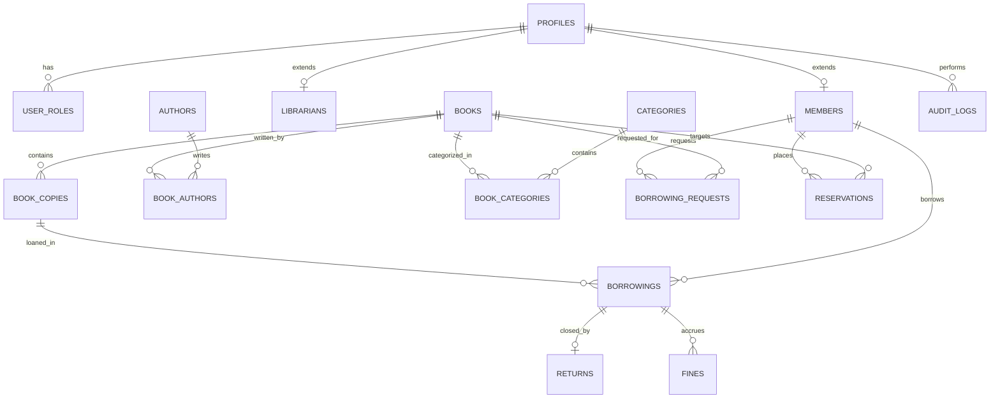

# The Library — Database Architecture & Schema Specification (`database.md`)

This document defines the complete PostgreSQL relational schema, indexes, transactional stored procedures, and Row Level Security (RLS) policies implemented on Supabase for **THE LIBRARY**.

---

## 1. Relational Entity Diagram



---

## 2. PostgreSQL Enumerated Types

```sql
-- Role classifications
CREATE TYPE app_role AS ENUM ('admin', 'librarian', 'member');

-- Membership operational status
CREATE TYPE member_status AS ENUM ('active', 'suspended', 'expired', 'pending');

-- Physical copy condition ratings
CREATE TYPE copy_condition AS ENUM ('excellent', 'good', 'fair', 'damaged');

-- Physical copy availability status
CREATE TYPE copy_status AS ENUM ('available', 'borrowed', 'reserved', 'maintenance', 'lost', 'retired');

-- Borrowing transaction status
CREATE TYPE borrowing_status AS ENUM ('active', 'returned', 'overdue', 'lost');

-- Request status for member actions
CREATE TYPE request_status AS ENUM ('pending', 'approved', 'rejected', 'cancelled');

-- Reservation queue status
CREATE TYPE reservation_status AS ENUM ('waiting', 'allocated', 'fulfilled', 'cancelled', 'expired');
```

---

## 3. Relational Table Definitions

### 3.1 `profiles` & Role Hierarchy
```sql
CREATE TABLE profiles (
    id UUID PRIMARY KEY REFERENCES auth.users(id) ON DELETE CASCADE,
    email TEXT UNIQUE NOT NULL,
    full_name TEXT NOT NULL,
    phone TEXT,
    avatar_url TEXT,
    created_at TIMESTAMPTZ DEFAULT NOW() NOT NULL,
    updated_at TIMESTAMPTZ DEFAULT NOW() NOT NULL
);

CREATE TABLE user_roles (
    id UUID PRIMARY KEY DEFAULT gen_random_uuid(),
    user_id UUID REFERENCES profiles(id) ON DELETE CASCADE NOT NULL,
    role app_role DEFAULT 'member'::app_role NOT NULL,
    assigned_at TIMESTAMPTZ DEFAULT NOW() NOT NULL,
    assigned_by UUID REFERENCES profiles(id),
    UNIQUE(user_id, role)
);

CREATE TABLE members (
    id UUID PRIMARY KEY REFERENCES profiles(id) ON DELETE CASCADE,
    member_code TEXT UNIQUE NOT NULL, -- e.g., 'MEM-2026-0042'
    status member_status DEFAULT 'active'::member_status NOT NULL,
    max_borrow_limit INT DEFAULT 5 NOT NULL,
    membership_expiry TIMESTAMPTZ NOT NULL,
    address TEXT,
    notes TEXT,
    created_at TIMESTAMPTZ DEFAULT NOW() NOT NULL
);

CREATE TABLE librarians (
    id UUID PRIMARY KEY REFERENCES profiles(id) ON DELETE CASCADE,
    employee_id TEXT UNIQUE NOT NULL,
    department TEXT DEFAULT 'Circulation' NOT NULL,
    is_active BOOLEAN DEFAULT true NOT NULL,
    created_at TIMESTAMPTZ DEFAULT NOW() NOT NULL
);
```

### 3.2 Catalog Architecture (Titles, Authors, Categories)
```sql
CREATE TABLE authors (
    id UUID PRIMARY KEY DEFAULT gen_random_uuid(),
    name TEXT NOT NULL,
    bio TEXT,
    born_year INT,
    created_at TIMESTAMPTZ DEFAULT NOW() NOT NULL
);

CREATE TABLE categories (
    id UUID PRIMARY KEY DEFAULT gen_random_uuid(),
    name TEXT UNIQUE NOT NULL,
    slug TEXT UNIQUE NOT NULL,
    description TEXT,
    created_at TIMESTAMPTZ DEFAULT NOW() NOT NULL
);

CREATE TABLE books (
    id UUID PRIMARY KEY DEFAULT gen_random_uuid(),
    title TEXT NOT NULL,
    subtitle TEXT,
    isbn TEXT UNIQUE,
    description TEXT,
    publisher TEXT,
    publication_year INT,
    edition TEXT,
    language TEXT DEFAULT 'English' NOT NULL,
    cover_image_url TEXT,
    shelf_location TEXT, -- e.g. 'Floor 2, Bay 4, Shelf C'
    tags TEXT[] DEFAULT '{}',
    is_featured BOOLEAN DEFAULT false NOT NULL,
    created_at TIMESTAMPTZ DEFAULT NOW() NOT NULL,
    updated_at TIMESTAMPTZ DEFAULT NOW() NOT NULL
);

CREATE TABLE book_authors (
    book_id UUID REFERENCES books(id) ON DELETE CASCADE NOT NULL,
    author_id UUID REFERENCES authors(id) ON DELETE CASCADE NOT NULL,
    PRIMARY KEY(book_id, author_id)
);

CREATE TABLE book_categories (
    book_id UUID REFERENCES books(id) ON DELETE CASCADE NOT NULL,
    category_id UUID REFERENCES categories(id) ON DELETE CASCADE NOT NULL,
    PRIMARY KEY(book_id, category_id)
);
```

### 3.3 Physical Book Copies Engine
```sql
CREATE TABLE book_copies (
    id UUID PRIMARY KEY DEFAULT gen_random_uuid(),
    book_id UUID REFERENCES books(id) ON DELETE RESTRICT NOT NULL,
    barcode TEXT UNIQUE NOT NULL, -- e.g. 'BC-10928471'
    copy_number INT NOT NULL,
    shelf_location TEXT,
    condition copy_condition DEFAULT 'excellent'::copy_condition NOT NULL,
    status copy_status DEFAULT 'available'::copy_status NOT NULL,
    acquisition_date DATE DEFAULT CURRENT_DATE NOT NULL,
    notes TEXT,
    created_at TIMESTAMPTZ DEFAULT NOW() NOT NULL,
    updated_at TIMESTAMPTZ DEFAULT NOW() NOT NULL,
    UNIQUE(book_id, copy_number)
);
```

### 3.4 Circulation Operations (Borrowings, Returns, Fines)
```sql
CREATE TABLE borrowings (
    id UUID PRIMARY KEY DEFAULT gen_random_uuid(),
    member_id UUID REFERENCES members(id) ON DELETE RESTRICT NOT NULL,
    copy_id UUID REFERENCES book_copies(id) ON DELETE RESTRICT NOT NULL,
    issued_by UUID REFERENCES librarians(id) ON DELETE SET NULL,
    borrowed_at TIMESTAMPTZ DEFAULT NOW() NOT NULL,
    due_date TIMESTAMPTZ NOT NULL,
    status borrowing_status DEFAULT 'active'::borrowing_status NOT NULL,
    renewal_count INT DEFAULT 0 NOT NULL,
    notes TEXT,
    created_at TIMESTAMPTZ DEFAULT NOW() NOT NULL
);

CREATE TABLE returns (
    id UUID PRIMARY KEY DEFAULT gen_random_uuid(),
    borrowing_id UUID UNIQUE REFERENCES borrowings(id) ON DELETE RESTRICT NOT NULL,
    processed_by UUID REFERENCES librarians(id) ON DELETE SET NULL,
    returned_at TIMESTAMPTZ DEFAULT NOW() NOT NULL,
    condition_on_return copy_condition NOT NULL,
    fine_amount DECIMAL(10, 2) DEFAULT 0.00 NOT NULL,
    notes TEXT,
    created_at TIMESTAMPTZ DEFAULT NOW() NOT NULL
);

CREATE TABLE fines (
    id UUID PRIMARY KEY DEFAULT gen_random_uuid(),
    member_id UUID REFERENCES members(id) ON DELETE RESTRICT NOT NULL,
    borrowing_id UUID REFERENCES borrowings(id) ON DELETE SET NULL,
    amount DECIMAL(10, 2) NOT NULL,
    reason TEXT NOT NULL, -- e.g. 'Overdue 4 days', 'Damaged binding'
    is_paid BOOLEAN DEFAULT false NOT NULL,
    paid_at TIMESTAMPTZ,
    created_at TIMESTAMPTZ DEFAULT NOW() NOT NULL
);
```

### 3.5 Approvals & Reservation Queue
```sql
CREATE TABLE borrowing_requests (
    id UUID PRIMARY KEY DEFAULT gen_random_uuid(),
    member_id UUID REFERENCES members(id) ON DELETE CASCADE NOT NULL,
    book_id UUID REFERENCES books(id) ON DELETE CASCADE NOT NULL,
    status request_status DEFAULT 'pending'::request_status NOT NULL,
    request_type TEXT DEFAULT 'borrow' NOT NULL, -- 'borrow', 'renewal'
    reviewed_by UUID REFERENCES librarians(id) ON DELETE SET NULL,
    reviewed_at TIMESTAMPTZ,
    rejection_reason TEXT,
    created_at TIMESTAMPTZ DEFAULT NOW() NOT NULL
);

CREATE TABLE reservations (
    id UUID PRIMARY KEY DEFAULT gen_random_uuid(),
    member_id UUID REFERENCES members(id) ON DELETE CASCADE NOT NULL,
    book_id UUID REFERENCES books(id) ON DELETE CASCADE NOT NULL,
    queue_position INT NOT NULL,
    status reservation_status DEFAULT 'waiting'::reservation_status NOT NULL,
    allocated_copy_id UUID REFERENCES book_copies(id) ON DELETE SET NULL,
    hold_expires_at TIMESTAMPTZ,
    created_at TIMESTAMPTZ DEFAULT NOW() NOT NULL
);
```

### 3.6 Immutable Audit Logs & Library Configuration
```sql
CREATE TABLE audit_logs (
    id UUID PRIMARY KEY DEFAULT gen_random_uuid(),
    actor_id UUID REFERENCES profiles(id) ON DELETE SET NULL,
    actor_role app_role NOT NULL,
    action TEXT NOT NULL,         -- e.g. 'book_created', 'copy_issued', 'member_suspended'
    entity_type TEXT NOT NULL,    -- e.g. 'books', 'borrowings', 'members'
    entity_id UUID NOT NULL,
    old_data JSONB,
    new_data JSONB,
    reason TEXT,
    ip_address TEXT,
    created_at TIMESTAMPTZ DEFAULT NOW() NOT NULL
);

CREATE TABLE library_settings (
    key TEXT PRIMARY KEY,
    value JSONB NOT NULL,
    updated_at TIMESTAMPTZ DEFAULT NOW() NOT NULL,
    updated_by UUID REFERENCES profiles(id)
);
```

---

## 4. Concurrency-Safe Stored Procedures

### 4.1 Atomic Copy Issue (`issue_book_copy`)
```sql
CREATE OR REPLACE FUNCTION issue_book_copy(
    p_member_id UUID,
    p_copy_id UUID,
    p_librarian_id UUID,
    p_loan_days INT DEFAULT 14
) RETURNS UUID AS $$
DECLARE
    v_borrowing_id UUID;
    v_member_status member_status;
    v_active_loans INT;
    v_max_loans INT;
    v_copy_status copy_status;
BEGIN
    -- 1. Verify and lock member record
    SELECT status, max_borrow_limit INTO v_member_status, v_max_loans
    FROM members WHERE id = p_member_id FOR UPDATE;

    IF v_member_status <> 'active' THEN
        RAISE EXCEPTION 'Member account is not active.';
    END IF;

    -- Check active loan limit
    SELECT COUNT(*) INTO v_active_loans
    FROM borrowings WHERE member_id = p_member_id AND status = 'active';

    IF v_active_loans >= v_max_loans THEN
        RAISE EXCEPTION 'Member has reached maximum borrowing limit (%).', v_max_loans;
    END IF;

    -- 2. Verify and lock physical copy
    SELECT status INTO v_copy_status
    FROM book_copies WHERE id = p_copy_id FOR UPDATE;

    IF v_copy_status <> 'available' THEN
        RAISE EXCEPTION 'Physical copy is not available (Current status: %).', v_copy_status;
    END IF;

    -- 3. Insert borrowing transaction
    INSERT INTO borrowings (member_id, copy_id, issued_by, due_date, status)
    VALUES (p_member_id, p_copy_id, p_librarian_id, NOW() + (p_loan_days || ' days')::INTERVAL, 'active')
    RETURNING id INTO v_borrowing_id;

    -- 4. Transition copy status to borrowed
    UPDATE book_copies SET status = 'borrowed', updated_at = NOW() WHERE id = p_copy_id;

    -- 5. Write audit entry
    INSERT INTO audit_logs (actor_id, actor_role, action, entity_type, entity_id, new_data)
    VALUES (p_librarian_id, 'librarian', 'copy_issued', 'borrowings', v_borrowing_id, jsonb_build_object('copy_id', p_copy_id, 'member_id', p_member_id));

    RETURN v_borrowing_id;
END;
$$ LANGUAGE plpgsql SECURITY DEFINER;
```

---

## 5. Performance Indexing Strategy

```sql
-- Fast catalog search indexes
CREATE INDEX idx_books_title_trgm ON books USING gin (title gin_trgm_ops);
CREATE INDEX idx_books_isbn ON books(isbn);
CREATE INDEX idx_books_featured ON books(is_featured) WHERE is_featured = true;

-- Copy barcode and availability lookups
CREATE INDEX idx_copies_barcode ON book_copies(barcode);
CREATE INDEX idx_copies_book_status ON book_copies(book_id, status);

-- Active borrowings and overdue tracking
CREATE INDEX idx_borrowings_active ON borrowings(status) WHERE status = 'active';
CREATE INDEX idx_borrowings_due_date ON borrowings(due_date);
CREATE INDEX idx_borrowings_member ON borrowings(member_id);

-- Reservation priority queue
CREATE INDEX idx_reservations_queue ON reservations(book_id, queue_position) WHERE status = 'waiting';

-- Audit log timeline
CREATE INDEX idx_audit_timeline ON audit_logs(created_at DESC);
```

---

## 6. Row Level Security (RLS) Policies

All tables have RLS enabled:
```sql
ALTER TABLE profiles ENABLE ROW LEVEL SECURITY;
ALTER TABLE members ENABLE ROW LEVEL SECURITY;
ALTER TABLE books ENABLE ROW LEVEL SECURITY;
ALTER TABLE book_copies ENABLE ROW LEVEL SECURITY;
ALTER TABLE borrowings ENABLE ROW LEVEL SECURITY;
ALTER TABLE borrowing_requests ENABLE ROW LEVEL SECURITY;
ALTER TABLE reservations ENABLE ROW LEVEL SECURITY;
ALTER TABLE audit_logs ENABLE ROW LEVEL SECURITY;
```

- **Catalog Read:** `books`, `authors`, `categories`, and `book_copies` count are readable by `public`.
- **Borrowings:**
  - Members can `SELECT` their own records (`auth.uid() = member_id`).
  - Staff (`librarian`, `admin`) can `SELECT`, `INSERT`, and `UPDATE` all records.
- **Audit Logs:**
  - `admin` has read access.
  - No user or staff role has `UPDATE` or `DELETE` access (strictly immutable).
