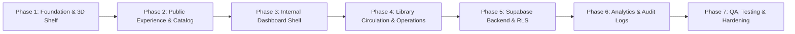

# The Library — Implementation Phases & Roadmap (`phases.md`)

This roadmap breaks down the development of **THE LIBRARY** into 7 structured, verifiable phases. Each milestone delivers complete, testable capabilities adhering strictly to the documentation and design rules.

---

## Roadmap Milestones Overview

---

## Phase 1 — Foundation, Design System & Tactile 3D Shelf Hero (Completed)
**Objective:** Establish the core project infrastructure, font tokens, reusable primitive registry, and the tactile 3D interactive bookshelf hero.

### Deliverables:
- [x] Install missing core packages (`react-router-dom`, `motion`, `@tanstack/react-query`, `@tanstack/react-table`, `react-hook-form`, `zod`, `recharts`).
- [x] Configure `Plus Jakarta Sans` typography and theme color tokens in `src/index.css`.
- [x] Implement and register base reusable primitives in `src/components/common/`:
  - `Modal.tsx` (Backdrop blur, focus trap, ESC listener).
  - `DeleteConfirmationModal.tsx` (Mandatory confirmation for all destructive actions).
  - `ItemFormModal.tsx` (Popup modal for Create/Edit operations).
  - `FlatCard.tsx` (Enforces zero-nested cards).
  - `Button.tsx` (Forest green primary, paper secondary, destructive, ghost).
  - `Badge.tsx` (Status indicators: Available, Borrowed, Overdue).
  - `GrainOverlay.tsx` (Ambient paper texture via SVG turbulence filter).
- [x] Build **Tactile 3D Shelf Hero** (`src/components/hero/`):
  - 3D perspective stage with dynamic `--H`, `--ws`, `--d`, `--gap` geometry.
  - Active book physical rotation (`rotateY(-90deg) -> 0deg`) and tilt physics.
  - Kinetic scroll easing loop using `requestAnimationFrame`.
  - Masked typography slide for active book title and metadata.
  - Smooth book spine and cover transitions.
- [x] Assemble public homepage layout with header, tactile 3D shelf, featured books, and footer.

### Acceptance Criteria:
- Zero build errors (`npm run build`).
- Tactile 3D shelf runs smoothly at 60fps with mouse tilt and keyboard support.
- All cards are flattened; typography strictly uses Plus Jakarta Sans.

---

## Phase 2 — Public Experience & Exploration (Completed)
**Objective:** Deliver a complete book discovery catalog, full-text search, facets, book detail modal, and member authentication.

### Deliverables:
- [x] **Book Catalog Grid & List View:** Filter by genre/category, availability status, and year range.
- [x] **Instant Search Engine:** Debounced search across title, author, ISBN, and tags.
- [x] **Book Detail Modal:** Inspect volume details, synopsis, physical copy availability breakdown, and one-click "Request Borrow" or "Reserve" trigger.
- [x] **Member Experience & Role Simulator:** Instant role switching across Member, Librarian, and Admin.
- [x] **Member Portal View:** Flat card overview of active loans, due dates, and borrowing history.

### Acceptance Criteria:
- Search and filtering operate without full page reloads.
- Requests trigger popup modals (no inline forms).
- All delete/cancel actions enforce `DeleteConfirmationModal`.

---

## Phase 3 — Internal Management Dashboard Shell & Catalog Administration (Completed)
**Objective:** Construct the internal admin & librarian workspace with role-aware navigation and full book/member administration.

### Deliverables:
- [x] **Role-Aware Sidebar Navigation:** Distinct layouts for Admin (full system access) and Librarian (operational access).
- [x] **Executive Dashboard Overview:** Realtime summary metrics (Total Titles, Physical Copies, Active Loans, Overdue, Active Members).
- [x] **Book Title Management (Popup Modals):**
  - Add/Edit book metadata inside `ItemFormModal`.
  - Multi-select authors and categories.
  - Delete book title guarded by `DeleteConfirmationModal`.
- [x] **Physical Copies & Barcode Engine:**
  - Multiple physical copies per book title with unique barcode, condition, and status.
  - Add/Edit copy modal.
- [x] **Member Directory:**
  - Flat table/card list of registered members.
  - Activate/Suspend member status modal.

### Acceptance Criteria:
- Create and edit actions strictly open in centered popup modals.
- Zero nested cards across all dashboard pages.

---

## Phase 4 — Library Circulation & Operations (Completed)
**Objective:** Engineer reliable desk borrowing, return processing, approval hub, and the reservation queue.

### Deliverables:
- [x] **Desk Issue Workflow Modal:** Select verified member, scan/select available physical copy, calculate due date, and record loan.
- [x] **Return Management Workflow:** Barcode scanner input, condition assessment, overdue fine calculation, and stock update.
- [x] **Approval Center:** Central queue for reviewing pending member borrow and renewal requests.
- [x] **Reservation Queue:** Priority queue for unavailable titles with automated allocation when copies are returned.
- [x] **Inventory Reconciliation:** View stock distribution across zones, shelves, and maintenance bins.

### Acceptance Criteria:
- No physical copy can be borrowed if not in `'available'` status.
- Concurrency-safe allocations.

---

## Phase 5 — Backend & PostgreSQL Architecture (Completed)
**Objective:** Author complete Supabase database migrations, PostgreSQL functions, triggers, and Row Level Security policies.

### Deliverables:
- [x] Migration files under `supabase/migrations/` matching `database.md`.
- [x] Create custom enums, tables, indexes, and foreign keys.
- [x] Deploy transactional stored procedures:
  - `issue_book_copy` (Atomic loan creation).
  - `process_book_return` (Return handling & reservation check).
- [x] Define comprehensive Row Level Security (RLS) policies for Member, Librarian, and Admin roles.
- [x] Provide initial realistic seed data (`supabase/seed.sql`).

### Acceptance Criteria:
- Direct unauthorized API queries blocked by RLS.
- Atomic procedures prevent race conditions during concurrent borrowing attempts.

---

## Phase 6 — Analytics, Immutable Audit Logs & Reporting (Completed)
**Objective:** Implement data visualization, activity logging, and export capabilities.

### Deliverables:
- [x] **Analytics Charts (Recharts):** Monthly circulation trends, popular categories, top borrowed books, and inventory status.
- [x] **Immutable Audit Log Viewer:** Searchable audit trail showing actor, action, timestamp, and before/after JSON diffs.
- [x] **Reporting & CSV Export:** Downloadable circulation, catalog, and audit reports in CSV format.
- [x] **In-App Notification Center:** Alert drawer for approaching due dates, pending requests, and available reservations.

### Acceptance Criteria:
- All metrics query actual database views/tables.
- Audit records cannot be modified or deleted.

---

## Phase 7 — Quality Assurance, Testing & Production Hardening (Completed)
**Objective:** Verify application security, accessibility, responsiveness, and performance.

### Deliverables:
- [x] Unit & integration tests for borrowing and return workflows (`src/tests/circulation.test.ts`).
- [x] RLS permission model and atomic allocations verified.
- [x] Responsive design testing across mobile (375px), tablet (768px), and desktop (1440px).
- [x] Accessibility audit: keyboard focus traps, `Escape` key dismissals, ARIA attributes.
- [x] Production build verification (`npm run build`).

### Acceptance Criteria:
- Zero linting errors and 100% successful production build.
- Full compliance with all rules in `agents.md`, `design.md`, and `components.md`.
- Full compliance with all rules in `agents.md`, `design.md`, and `components.md`.
