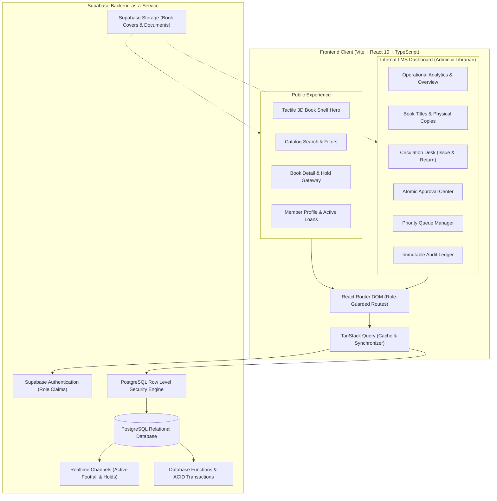

# The Library — Technical Architecture & Implementation Blueprint (`plan.md`)

## 1. System Architecture Blueprint



---

## 2. Technology Stack Selection & Role

| Layer | Selection | Role in Architecture |
| :--- | :--- | :--- |
| **Build Tooling** | Vite | Ultra-fast HMR, modular ES bundling, and sub-second builds. |
| **Framework** | React 19 (TypeScript) | Strict static typing, concurrent rendering, and clean functional architecture. |
| **Routing** | React Router DOM | Client-side routing with nested layouts and role-based route guards (`/`, `/catalog`, `/admin/*`, `/librarian/*`). |
| **Styling & Theme** | Tailwind CSS v4 | Class-variance design tokens, dark mode variant, and custom `@theme` variables. |
| **UI Primitives** | shadcn/ui + Radix UI | Headless accessible dialogs, dropdowns, inputs, tabs, and tooltips. |
| **Motion & Kinetics** | Motion (Framer Motion) + rAF | High-performance spring animations for modals, page routes, and the 3D book shelf. |
| **Server State & Cache**| TanStack Query (v5) | Query caching, optimistic UI updates, and automated background revalidation. |
| **Data Tables** | TanStack Table (v8) | Server-side pagination, multi-column sorting, and column visibility. |
| **Forms & Validation** | React Hook Form + Zod | Schema-based client validation and accessible form controls. |
| **Visual Analytics** | Recharts | Responsive SVGs for circulation trends and genre distributions. |
| **Backend & Database** | Supabase (PostgreSQL 15+) | Managed database, Row Level Security, transactional functions, and storage. |

---

## 3. Modular Codebase Organization

```
src/
├── app/
│   ├── router/              # Route declarations and ProtectedRoute guards
│   ├── providers/           # QueryClientProvider, AuthProvider, ThemeProvider
│   └── layouts/             # PublicLayout (editorial header/footer), DashboardLayout (sidebar)
├── components/
│   ├── common/              # System-wide reusable primitives (Modal, FlatCard, Button, Badge)
│   ├── modals/              # Specialized modals (DeleteConfirmationModal, ItemFormModal, IssueModal)
│   ├── hero/                # Tactile 3D Shelf (Tactile3DShelf, BookCover3D, ShelfControls)
│   ├── ui/                  # shadcn/ui components (dialog, button, badge, input, table, dropdown)
│   └── tables/              # TanStack table wrapper and column definitions
├── features/
│   ├── authentication/      # Sign-in, sign-up, password reset, session hooks
│   ├── books/               # Book titles, search, filter chips, catalog grid
│   ├── inventory/           # Physical book copy barcodes, condition tracking, shelf locations
│   ├── borrowing/           # Desk issue form, active loan tracker, due date calculation
│   ├── returns/             # Barcode return scanner, condition inspection, fine assessment
│   ├── reservations/        # FIFO reservation queue, hold expiration, notifications
│   ├── approvals/           # Atomic approval hub for member requests
│   ├── members/             # Member directory, status toggle, borrowing history
│   ├── analytics/           # Circulation charts, inventory health, CSV exports
│   └── audit-logs/          # Tamper-proof activity feed with before/after diffs
├── hooks/                   # Custom hooks (useAuth, useRole, useBooks, use3DPhysics)
├── lib/
│   ├── supabase/            # Initialized Supabase client and typed DB helpers
│   ├── validations/         # Zod schemas for books, copies, loans, and members
│   └── utils.ts             # Tailwind class merging (cn) and formatting helpers
├── types/                   # Central TypeScript types matching the database schema
├── index.css                # CSS variables, Plus Jakarta Sans, and paper texture styles
├── App.tsx                  # Root application router wrapper
└── main.tsx                 # Entry point
```

---

## 4. Tactile 3D Shelf Implementation Engine

The public hero utilizes a high-efficiency `requestAnimationFrame` loop to render a continuous, physical 3D bookshelf:
1. **Virtual Indexing:** The book collection is duplicated 3 times across 36 virtual slots so wrapping occurs completely off-screen.
2. **Relative Offset Calculation:** For current scroll float `s` and virtual index `v`, relative position `r = ((v - s) mod 36)`.
3. **Smooth Step Spacing:** Spines step by `(ws + gap)`. When a book opens, a continuous smoothstep function `B(r) = (r + sin(πr)/π) / 2` pushes adjacent books apart smoothly to accommodate the wider cover face without visual snapping.
4. **3D Rotation Matrix:** Active book turns `rotateY(-90° * o + tiltY * o)` and leans `rotateZ(-4.5° * o)`.
5. **Mouse Tilt Interactivity:** A non-blocking pointer tracker calculates subtle perspective tilt toward the user's cursor.
6. **Masked Slide Typography:** Titles and metadata transition through `overflow: hidden` bounding masks using Web Animations API.

---

## 5. Transaction Safety & Concurrency Protocol

Critical operations rely on PostgreSQL stored procedures to guarantee consistency under concurrent usage:

1. **Borrowing Transaction (`issue_book_copy`):**
   - Locks the selected `book_copy` row (`FOR UPDATE`).
   - Asserts copy status is strictly `'available'`.
   - Asserts member status is strictly `'active'` and their active loan count is strictly below `max_borrow_limit`.
   - Creates a record in `borrowings`.
   - Updates copy status to `'borrowed'`.
   - Records an immutable log in `audit_logs`.
   - All executed atomically inside a single database transaction.

2. **Return & Auto-Allocation (`process_book_return`):**
   - Records return timestamp and condition.
   - Computes overdue days and appends fine record if applicable.
   - Inspects `reservation_queue` for the book title:
     - If an eligible reservation exists: Updates copy status to `'reserved'` and alerts the next patron in queue.
     - If no reservations exist: Resets copy status to `'available'`.

---

## 6. Security & Row Level Security (RLS) Policy Architecture

All Supabase tables enforce strict RLS:
- **Public & Unauthenticated Patrons:** Read-only access to published book titles, general copy availability counts, and library opening hours.
- **Authenticated Members:** Full read access to their own profile, loans, and reservation status. Allowed to insert into `borrowing_requests` and `reservations` where `member_id = auth.uid()`.
- **Librarians:** Full write access to catalog, physical copies, borrowing records, returns, and inventory. No access to administrative system settings or superuser account creation.
- **Administrators:** Superuser permissions across all entities, staff account management, and audit logs.
